# Enterprise Project Analysis & Architecture Mapping
**Platform:** RealEstateIQ — AI-Powered Global PropTech Platform  
**Version:** 2.4.0-Enterprise  
**Audit Date:** November 2026  
**Auditor:** Principal Enterprise QA & Solutions Architect  
**Classification:** Confidential / Production Assessment  

---

## 1. Executive Summary

RealEstateIQ is a multi-tier, AI-driven real estate intelligence platform delivering automated valuation, transaction lifecycle management, multi-jurisdiction financial analysis, and portfolio tracking. The platform operates across a modern microservices-inspired architecture comprising:
- **Next.js 15 Frontend:** React 19, TypeScript 5, Tailwind CSS, TanStack React Query v5, Framer Motion, and Leaflet Maps.
- **Node.js 20 Backend:** Express.js, TypeScript, Mongoose ODM, MongoDB Atlas / Enterprise, JWT authentication, Winston logging, Nodemailer SMTP, and PayHere / Cloudinary integrations.
- **Python 3.12 ML Microservice:** FastAPI / Uvicorn, Scikit-learn Gradient Boosting Regressor, SHAP (SHapley Additive exPlanations) explainability engine, Joblib model pipeline, and Pandas.
- **CI/CD Automation:** GitHub Actions running automated multi-environment matrix testing for Backend, Frontend, and ML services.

---

## 2. System Architecture Diagram

```mermaid
flowchart TD
    User([Global Users / Investors / Agents]) -->|HTTPS / WSS| CDN[Cloudflare / Edge CDN]
    CDN -->|Static Assets & SSR| NextFrontend[Next.js 15 Luxury Frontend\nPort: 3000]
    
    subgraph Frontend Client Engine
        NextFrontend --> AuthCtx[Auth Context & JWT]
        NextFrontend --> CurrCtx[Currency Engine LKR / USD / GBP / AED / AUD]
        NextFrontend --> UnitCtx[Unit Converter Sq.ft / Perch / Acre / Sq.m]
        NextFrontend --> LangCtx[i18n Localization EN / TA / SI]
        NextFrontend --> MapCluster[Leaflet MarkerCluster Engine]
    end

    NextFrontend -->|REST API Requests / JSON| ExpressAPI[Node.js 20 Express Backend\nPort: 5000]

    subgraph Backend Microservices
        ExpressAPI --> AuthMW[JWT & RBAC Middleware]
        ExpressAPI --> HelmetRate[Helmet Security & Rate Limiter]
        ExpressAPI --> PropertyCtrl[Property & Valuation Controller]
        ExpressAPI --> OfferCtrl[Make an Offer & Rental Engine]
        ExpressAPI --> InquiryCtrl[Inquiries & Email Dispatcher]
        ExpressAPI --> PayHereCtrl[PayHere Gateway & Boost Monetization]
    end

    ExpressAPI -->|Internal HTTP / Prediction Endpoint| FastAPI[Python 3.12 ML Service\nPort: 8000]
    
    subgraph Machine Learning Pipeline
        FastAPI --> GBRModel[Gradient Boosting Regressor Model]
        FastAPI --> SHAPEngine[SHAP TreeExplainer & Impact Waterfall]
        FastAPI --> FeaturePreprocessor[Location, Bedrooms, Bathrooms, Area, Age Pipeline]
    end

    ExpressAPI -->|Mongoose Connection Pool| MongoDB[(MongoDB Enterprise / Atlas Cluster)]
    ExpressAPI -->|Media Uploads / CDN| CloudinaryAPI[Cloudinary Cloud Storage]
    ExpressAPI -->|Transactional Emails| SMTPServer[Gmail / Enterprise SMTP Server]
```



### Clean Production Repository Layout
```text
RealEstateIQ/
├── .github/workflows/ci.yml       # Automated GitHub Actions CI/CD matrix pipeline
├── backend/                       # Node.js 20 Express TypeScript REST API server
├── frontend/                      # Next.js 15 React 19 Luxury Frontend Web App
├── ml-service/                    # Python 3.12 FastAPI Machine Learning Microservice
├── QA_DOCUMENTATION/              # 14-Document Master Enterprise QA Audit Suite
├── docs/                          # Architecture blueprints and system analysis specs
├── docker-compose.yml             # Multi-container orchestration specification
├── DEPLOYMENT.md                  # Comprehensive step-by-step deployment guide
├── README.md                      # Technical project documentation and developer guide
└── render.yaml                    # Render.com multi-service blueprint
```

---

## 3. Technology Stack Inventory

| Component | Technology | Version | Purpose |
|---|---|---|---|
| **Frontend Framework** | Next.js (Pages Router) | 15.1.0 | Server-side rendering, client hydration, dynamic routing |
| **UI Library** | React & React DOM | 19.0.0 | Component hierarchy, virtual DOM, interactive widgets |
| **Language (UI & API)** | TypeScript | 5.3.3 | Static typing, interface contracts, compile-time safety |
| **Styling & Design** | Tailwind CSS | 3.4.1 | Utility-first CSS, Obsidian Glass luxury dark theme |
| **State & Data Fetching** | TanStack React Query | 5.17.0 | Server state caching, optimistic updates, query invalidation |
| **Mapping Engine** | Leaflet + Leaflet.markercluster | 1.9.4 | Interactive maps, viewport clustering, spatial navigation |
| **Backend Framework** | Express.js | 4.19.2 | RESTful routing, middleware orchestration, JSON serialization |
| **Database ODM** | Mongoose | 8.2.1 | MongoDB schema enforcement, indexing, hooks, query builder |
| **Machine Learning API** | FastAPI / Uvicorn | 0.109.0 | High-performance async ML inference microservice |
| **Predictive Modeling** | Scikit-learn | 1.4.0 | Gradient Boosting Regressor for property market valuation |
| **Explainable AI (XAI)** | SHAP | 0.44.1 | Shapley value breakdown of feature price contributions |
| **Payment Gateway** | PayHere SDK | Custom MD5 hash | Sri Lankan and international credit/debit card processing |
| **Authentication** | JSON Web Tokens (JWT) & bcryptjs | 9.0.2 / 2.4.3 | Stateless token authorization, salted password hashing |
| **CI/CD Platform** | GitHub Actions | v4 runners | Automated build, lint, typecheck, and test matrix pipeline |

---

## 4. Component Interaction & Communication Protocols

1. **User Authentication Flow:**
   - User submits credentials (`/api/auth/login`) or registers (`/api/auth/register`).
   - Passwords hashed using bcrypt (10 salt rounds).
   - Backend issues signed HS256 JWT containing `userId` and `role`.
   - Frontend stores token in `localStorage` and injects via Axios interceptor `Authorization: Bearer <token>`.

2. **Valuation & Explainable AI Pipeline:**
   - User triggers prediction request with property parameters (location, area, beds, baths, age, property type).
   - Express backend routes request to Python ML service (`POST http://localhost:8000/predict`).
   - ML model executes Gradient Boosting inference, generating estimated price in LKR.
   - SHAP explainer generates localized Shapley contributions (positive vs negative impact factors).
   - Express merges prediction with historical market district trends and stores transaction log in MongoDB.

3. **Internationalization & Jurisdiction Adaptation:**
   - Client selects country jurisdiction (Sri Lanka, USA, UK, UAE, Australia).
   - System auto-synchronizes:
     - Currency (LKR, USD, GBP, AED, AUD) with real-time exchange multiplier.
     - Measurement Units (Perches, Acres, Sq.ft, Sq.m).
     - Legal compliance, conveyancing tax brackets, and stamp duty rates.
     - Language interface (English, தமிழ், සිංහල).

---

## 5. Environment Variables & Security Matrix

| Variable Name | Component | Sensitivity | Purpose |
|---|---|:---:|---|
| `PORT` | Backend | Low | Express server listening port (default: 5000) |
| `NODE_ENV` | Backend / Frontend | Low | Runtime mode (`development` / `production`) |
| `MONGODB_URI` | Backend | High | MongoDB connection string with credentials |
| `JWT_SECRET` | Backend | Critical | HMAC secret key used for signing user session tokens |
| `JWT_EXPIRES_IN` | Backend | Medium | Session token lifespan (e.g. `7d`) |
| `PAYHERE_MERCHANT_ID` | Backend | High | Merchant identifier for PayHere payment gateway |
| `PAYHERE_SECRET` | Backend | Critical | Secret passphrase for generating payment MD5 signatures |
| `SMTP_HOST` / `SMTP_USER` / `SMTP_PASS` | Backend | High | Mail server credentials for OTP and inquiry notifications |
| `CLOUDINARY_URL` | Backend | High | Cloud image hosting API connection string |
| `NEXT_PUBLIC_API_URL` | Frontend | Low | Base URL of Express backend REST endpoint |
| `ML_SERVICE_URL` | Backend | Medium | Internal URL of Python FastAPI inference microservice |

---

## 6. Architecture Review Verdict

> [!NOTE]
> The architectural separation of concerns between Next.js, Express, and FastAPI ensures strong horizontal scalability. Compute-heavy ML inference runs in an isolated Python process without blocking the Node.js event loop, while Next.js handles static and client hydration tasks smoothly.

**Readiness Grade:** **A- (Enterprise Production Tier)**
