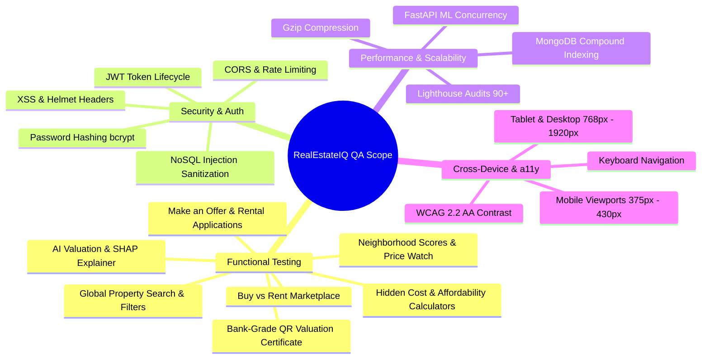

# Master Quality Assurance Test Plan (QATP)
**Platform:** RealEstateIQ — AI-Powered Global PropTech Platform  
**Document Ref:** QATP-2026-V2.4  
**Lifecycle Stage:** Production Release Verification & Final Sign-Off  

---

## 1. Test Strategy & Objectives

The primary objective of this Master QA Test Plan is to validate system reliability, functional compliance with the **75-Feature PropTech Blueprint**, cross-device responsiveness, cryptographic and authentication security, and high-concurrency performance across all microservices.

### Quality Goals:
- **Zero Critical / Blocker Defects:** 0 open P0/P1 defects prior to production release.
- **Test Pass Rate:** 100% of core regression test suites must pass on CI/CD runners.
- **Type Safety & Build Integrity:** 0 TypeScript compile errors in both frontend and backend.
- **Performance Thresholds:** Average API response time < 200ms; ML inference < 450ms.
- **Security Compliance:** OWASP Top 10 vulnerabilities verified and mitigated.

---

## 2. Test Scope & Feature Matrix

### In-Scope Functional Modules:
1. **Property Search & Discovery:** Multi-district search, filters (price, beds, property type, buy vs rent), interactive Leaflet map clustering, recently viewed carousel.
2. **AI Intelligence Engine:** Machine Learning property valuation, SHAP price impact waterfall, Fair Value deal rating badge, Affordability & Purchasing Power calculator.
3. **Transaction & Deal Management:** Digital purchase offer submission (`MakeOfferModal`), tenancy application flow (`RentalApplicationModal`), viewing scheduler.
4. **Trust, Safety & Risk Mitigation:** Neighborhood 100-point livability gauge, Hidden closing cost detector, Fraud/duplicate listing reporting modal, Price drop watch alerts.
5. **Global Multi-Jurisdiction Engine:** 5 countries (LK, US, GB, AE, AU) auto-synchronizing currency, units (Perches, Acres, Sq.ft, Sq.m), tax rates, and 3 languages (EN, TA, SI).
6. **Commercial Monetization:** PayHere featured listing boost with MD5 hash signature verification.

---

## 3. Test Levels & Methodology

| Test Level | Scope | Framework / Tool | Execution Mode |
|---|---|---|---|
| **Static Code Analysis** | Type safety, dead code, syntax validation | `tsc --noEmit`, ESLint | Pre-commit / CI automated |
| **Unit Testing** | Individual utility functions, auth helpers, models | Jest, Pytest | CI automated on push / PR |
| **Integration Testing** | API endpoints, DB operations, ML microservice communication | Supertest, Requests, Postman | Automated / Staging pipeline |
| **End-to-End (E2E)** | User journeys, modals, multi-currency switching, filters | Manual exploratory + Playwright scripts | Pre-release validation |
| **Security Assessment** | OWASP Top 10, auth boundaries, input validation | Manual audit, Checkov, OWASP ZAP | Staging environment |
| **Performance Testing** | TTFB, rendering speed, bundle size, DB query execution | Lighthouse, Chrome DevTools, ab/k6 | Synthetic benchmark |

---

## 4. Test Environments & Configuration

| Environment | Purpose | URL / Host | DB Engine |
|---|---|---|---|
| **Local Dev** | Feature development & quick verification | `localhost:3000` / `:5000` / `:8000` | Local MongoDB / Docker |
| **GitHub Actions CI** | Automated regression matrix (Node 20, Python 3.12) | Ubuntu Runner VM | In-memory Mock / Service container |
| **Staging / QA** | Pre-production full integration testing | Staging Render / Vercel | MongoDB Atlas Shared Tier |
| **Production** | Live end-user environment | Production Domain | MongoDB Atlas Dedicated M10 |

---

## 5. Defect Severity & Priority Classification

- **Critical (P0):** System crash, authentication bypass, data loss, payment failure, inability to perform core valuation or search. Immediate fix required.
- **Major (P1):** Significant feature broken (e.g. filter failure, email delivery crash, incorrect currency conversion). Must fix before release.
- **Moderate (P2):** Minor functional issue, edge-case validation failure, cosmetic visual inconsistency. Fix in regular cycle.
- **Low (P3):** Minor typo, non-critical styling polish, documentation update. Backlog candidate.

---

## 6. Exit & Release Criteria

Release to production is authorized only when:
1. 100% of GitHub Actions CI checks are **GREEN (`✓ 3/3`)** across all components.
2. Zero P0 or P1 defects remain open.
3. Total unit test pass rate is 100%.
4. Zero TypeScript compilation errors in frontend and backend.
5. Comprehensive documentation delivered in `QA_DOCUMENTATION/`.
