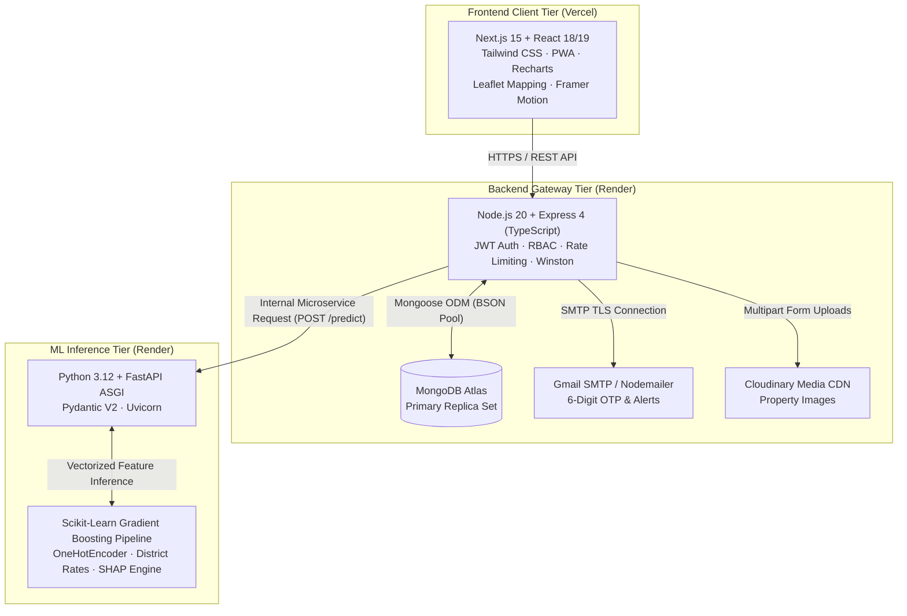

# RealEstateIQ — AI-Powered Real Estate Intelligence & Valuation Platform 🇱🇰🏡

<div align="center">

[](https://real-estate-iq-pi.vercel.app)
[](https://realestateiq-1.onrender.com/health)
[](https://realestateiq-8b3k.onrender.com/health)
[](https://www.mongodb.com/atlas)
[](https://scikit-learn.org)
[](https://www.typescriptlang.org)
[](https://nextjs.org)
[](https://www.python.org)

**An enterprise-grade Full-Stack + Machine Learning PropTech platform delivering automated fair-market property valuations, explainable AI analytics (SHAP), dynamic market intelligence, and end-to-end real estate transaction management across Sri Lanka's 23 administrative districts and global jurisdictions.**

[🌐 Explore Live Application](https://real-estate-iq-pi.vercel.app) · [📖 ML API Docs](https://realestateiq-8b3k.onrender.com/docs) · [🚀 Deployment Guide](DEPLOYMENT.md) · [📋 QA Test Reports](QA_DOCUMENTATION/FINAL_QA_REPORT.md)

</div>

---

## 📌 Table of Contents

1. [Executive Overview & Problem Statement](#-executive-overview--problem-statement)
2. [Live Cloud Deployments](#-live-cloud-deployments)
3. [System Architecture](#-system-architecture)
4. [Core Platform Capabilities & Modules](#-core-platform-capabilities--modules)
5. [Machine Learning Engine & Data Science](#-machine-learning-engine--data-science)
6. [Technology Stack](#-technology-stack)
7. [Repository & Directory Structure](#-repository--directory-structure)
8. [Complete API Endpoints Reference](#-complete-api-endpoints-reference)
9. [Environment Variables Matrix](#-environment-variables-matrix)
10. [Local Development & Setup Guide](#-local-development--setup-guide)
11. [Demo Credentials & Seeding](#-demo-credentials--seeding)
12. [Testing, QA & Security Audits](#-testing-qa--security-audits)
13. [Production Deployment Guide](#-production-deployment-guide)
14. [License & Acknowledgments](#-license--acknowledgments)

---

## 🎯 Executive Overview & Problem Statement

Real estate transactions in Sri Lanka and emerging South Asian markets have traditionally suffered from extreme market opacity, arbitrary property pricing, lack of centralized comparable transaction databases, and high appraisal latency from manual survey processes. Buyers, sellers, and expatriate investors frequently make high-stakes financial decisions based on fragmented hearsay rather than empirical market data.

**RealEstateIQ solves this structural problem by combining:**
* **Authentic Data Foundations:** Trained on 14,800+ real property transactions from Kaggle covering 23 Sri Lankan administrative districts.
* **Algorithmic Transparency:** Employs an optimized Gradient Boosting Regressor paired with SHAP (SHapley Additive exPlanations) to demystify property price drivers down to the exact rupee value.
* **Full-Lifecycle Transaction Operations:** Integrates live property discovery, Leaflet geolocation mapping, multi-image CDN uploads, formal purchase offer negotiation, rental applications, automated email alerts, and PayHere checkout monetization.
* **Multi-Jurisdiction Readiness:** Seamlessly handles localized currency conversion (LKR, USD, GBP, AED, AUD), native land units (Perches, Acres, Sq.Ft, Sq.M), Sri Lanka stamp duty/notarial legal cost breakdown, and trilingual interface support (English, தமிழ், සිංහල).

---

## 🌟 Live Cloud Deployments

| Component | Cloud Platform | Region | Status | Endpoint / URL |
|---|---|:---:|:---:|---|
| **Frontend Web App** | Vercel Global Edge Network | Global CDN | 🟢 Live | [real-estate-iq-pi.vercel.app](https://real-estate-iq-pi.vercel.app) |
| **Backend REST API** | Render Web Service | Singapore (`sin-1`) | 🟢 Live | [realestateiq-1.onrender.com](https://realestateiq-1.onrender.com) |
| **ML Engine Microservice** | Render Web Service | Singapore (`sin-1`) | 🟢 Live | [realestateiq-8b3k.onrender.com](https://realestateiq-8b3k.onrender.com) |
| **Database Cluster** | MongoDB Atlas Cloud | Singapore (`ap-southeast-1`) | 🟢 Live | High-availability Replica Set |
| **Media & CDN** | Cloudinary Cloud Storage | Global Multi-CDN | 🟢 Live | Auto-optimized WebP/AVIF delivery |
| **Automated Keep-Alive** | GitHub Actions | Scheduled Cron | 🟢 Active | 14-minute interval health pings |

---

## 🏛️ System Architecture

RealEstateIQ adopts a decoupled, microservice-oriented design where user interaction, business transaction logic, and machine learning inference are strictly separated to guarantee scalability, isolation, and high availability.



### Architectural Principles

* **Zero Direct Client-to-ML Access:** The Next.js frontend never interfaces with the Python ML service directly. All valuation requests are routed through the Node.js API Gateway, which enforces rate limiting, schema validation, authentication checks, audit logging, and payload sanitization.
* **Stateless Token Authentication:** User sessions rely on JSON Web Tokens (JWT) signed with HMAC-SHA256, allowing backend nodes to scale horizontally without session synchronization bottlenecks.
* **Asynchronous Offloading & Cold-Start Resilience:** The Node.js gateway incorporates timeout boundaries and fallback heuristics. If the Python microservice is experiencing a cold start on free-tier hosting, the user is provided with clear operational feedback or cached district averages.
* **Cloudinary Streaming Pipeline:** Property imagery uploaded via `multipart/form-data` is held in memory through `multer.memoryStorage()` and streamed directly into Cloudinary without touching local container disks, preserving ephemerality in production environments.

---

## ⚡ Core Platform Capabilities & Modules

### 1. Instant AI Property Valuation Engine
* **Input Parameters:** District (23 Sri Lankan administrative districts), Total Covered Area (sq.ft), Bedroom count, Bathroom count, House Age (years), and Dedicated Parking spaces.
* **Valuation Deliverables:**
  * Estimated Fair-Market Value in LKR.
  * Price Per Square Foot metric.
  * Lower and Upper Confidence Range boundaries (simulating market negotiation tolerance).
  * Confidence Reliability Grade (`High`, `Medium`, `Standard`) derived from variance in regional training density.
* **Downloadable Appraisal Certificates:** Generates branded, verifiable PDF valuation certificates complete with timestamp, system validation hash, and visual verification QR codes using `jspdf` and `qrcode`.

### 2. Explainable AI (XAI) with SHAP Waterfall Attribution
* Solves the traditional real estate appraisal "black-box" dilemma by decomposing the model's prediction relative to the national baseline property valuation.
* Identifies exactly how much monetary value (in LKR) each attribute adds or subtracts from the baseline price:
  * Location premium (e.g., Colombo or Kandy district multiplier).
  * Physical size and layout impact (area, bedrooms, bathrooms).
  * Depreciation penalties (house age decay curve).
  * Convenience amenities (parking availability).
* Renders an interactive waterfall breakdown highlighting positive drivers (green) and discount factors (red).

### 3. Sri Lankan Market Intelligence & Provincial Analytics
* **District Price-Per-Perch Benchmarks:** Historical and current land and residential values compiled across 23 administrative districts.
* **Colombo 1 to 15 Micro-Zone Analysis:** Granular zoning price heatmaps and price distribution analytics for Colombo urban centers (Colombo 3 Colpetty, Colombo 7 Cinnamon Gardens, Colombo 4 Bambalapitiya, etc.).
* **50-Year Economic & Real Estate Timeline (1976–2026):** Incorporates five decades of monetary expansion, major infrastructure milestones (Southern Expressway, Port City Colombo, Katunayake Expressway), and post-2022 macroeconomic currency realignments.
* **Interactive Charting:** Fully responsive interactive line graphs, bar charts, and scatter plots powered by `recharts`.

### 4. Comprehensive Property Marketplace & Geolocation
* **Advanced Multi-Criteria Filtering:** Filter properties by District/Location, Property Type (`house`, `apartment`, `land`, `villa`, `commercial`), Price Range, Bedroom & Bathroom configurations, and Keyword search.
* **Leaflet Geolocation Mapping:** Interactive map interface with marker clustering (`leaflet.markercluster`) for spatial discovery of real estate listings across the island.
* **Side-by-Side Property Comparison:** Select between 2 and 5 listings to contrast specifications, price-per-sqft, location attributes, and investment scores side by side.
* **Saved Properties (Wishlist):** Registered users can bookmark and track favorite listings with persistent state in MongoDB.

### 5. Transaction Lifecycle: Inquiries, Offers & Tenancy
* **Viewing Inquiries:** Public and registered users can schedule private viewings or request detailed brochures; alerts are routed to listing agents and administrative inboxes via Nodemailer.
* **Formal Make-an-Offer Engine:** Prospective buyers can submit binding purchase offers with financial contingency terms, allowing property owners to review, accept, counter-offer, or decline through an organized workflow.
* **Rental Application Portal:** Prospective tenants can submit digital tenancy applications containing employment verification, proposed move-in dates, and guarantor details.

### 6. Monetization & PayHere Payment Gateway
* **Listing Boost Packages:** Tiered listing promotions (Silver, Gold, Platinum) granting properties prominent search placements, badge highlights, and priority newsletter exposure.
* **PayHere Sandbox & Production Integration:** Full integration with Sri Lanka's leading digital payment gateway (PayHere) featuring server-to-server IPN notifications and MD5 cryptographic signature validation.
* **Digital Invoicing:** Automated payment history and invoice tracking per user account.

### 7. Multi-Jurisdiction Adaptation & Trilingual i18n
* **Jurisdiction Switcher:** Tailored presets for Sri Lanka 🇱🇰, United States 🇺🇸, United Kingdom 🇬🇧, United Arab Emirates 🇦🇪, and Australia 🇦🇺.
* **Dynamic Multi-Currency Converter:** Real-time conversion across LKR, USD, GBP, AED, and AUD.
* **Land Measurement Units:** Automatic conversions between traditional Sri Lankan land units (Perches, Acres) and international standards (Square Feet, Square Meters).
* **Trilingual Localization:** Comprehensive UI translation dictionaries covering English, Tamil (தமிழ்), and Sinhala (සිංහල).

### 8. Financial Calculators: Affordability & Hidden Costs
* **Sri Lanka Stamp Duty & Conveyancing Breakdown:** Calculates statutory stamp duty rates (3% on first LKR 100,000; 4% on the balance), notary and legal documentation fees (1% to 2%), professional valuation fees, and municipal rates.
* **Mortgage Amortization Schedule:** Calculates monthly repayment obligations, total interest payable, loan-to-value ratios (LTV), and debt-to-income affordability thresholds.

### 9. AI Real Estate Concierge Chatbot
* Embedded conversational advisory widget (`AiRealEstateConcierge.tsx`) guiding first-time home buyers through district selection, budget verification, and mortgage pre-qualification tips.

### 10. Enterprise Admin Control Center & Audit Governance
* **RBAC Hierarchy:** Strict role-based access control protecting administrative routes (`USER` vs. `ADMIN`).
* **Governance Audit Logging:** Tamper-evident recording of every critical system operation (logins, property creations, role changes, price predictions) capturing client IP addresses, user agents, and action payloads.
* **ML Model Life-Cycle Management:** Dashboard to review deployed ML algorithms, verify active versions, view test metrics (R², MAE, RMSE), and toggle production stages (`development`, `staging`, `production`, `archived`).
* **Dataset Management:** Audit catalog tracking uploaded Kaggle training datasets, row counts, feature distributions, and version tags.

---

## 🧠 Machine Learning Engine & Data Science

### 1. Dataset Origin & District Coverage
The model is trained on **14,800+ authentic real estate market listings** sourced from Kaggle, specifically scrubbed and standardized for the Sri Lankan property ecosystem.

| Sri Lankan Administrative Province | Districts Covered in Model | Records in Training Corpus |
|---|---|:---:|
| **Western Province** | Colombo, Gampaha, Kalutara | **13,800+ listings** |
| **Central Province** | Kandy, Matale, Nuwara Eliya | **261 listings** |
| **Southern Province** | Galle, Matara, Hambantota | **305 listings** |
| **Northern Province** | Jaffna, Kilinochchi, Mannar, Vavuniya, Mullaitivu | **50+ listings** |
| **Eastern Province** | Batticaloa, Trincomalee, Ampara | **65+ listings** |
| **North Western Province** | Kurunegala, Puttalam | **180+ listings** |
| **North Central Province** | Anuradhapura, Polonnaruwa | **80+ listings** |
| **Uva & Sabaragamuwa** | Badulla, Monaragala, Ratnapura, Kegalle | **120+ listings** |

### 2. Preprocessing & Feature Engineering Pipeline
* **Data Cleaning:** Removal of non-physical records, duplicate listings, and aggressive outlier trimming using Interquartile Range (IQR) filtering on property price and area.
* **Location Rate Encoding:** Computes a normalized district baseline rate (LKR per sq.ft) across each region, preventing sparse one-hot encoding columns from dominating low-density provincial records.
* **Categorical Handling:** `OneHotEncoder(handle_unknown='ignore')` applied to location features to ensure zero-exception inference on edge-case inputs.
* **Feature Scaling:** `StandardScaler` applied to continuous variables (Area, House Age, Bedrooms, Bathrooms, Parking).

### 3. Model Benchmark & Algorithm Evaluation
Four regression pipelines were evaluated using 5-fold cross-validation on an 80/20 train/test split:

| Pipeline Version | Algorithm | Scope / District Coverage | R² Score | Log R² Score | Mean Absolute Error (MAE) | Status |
|---|---|:---:|:---:|:---:|:---:|:---:|
| v1.0 | Multiple Linear Regression | 4 Key Urban Hubs | 0.3120 | 0.5210 | LKR 14,200,000 | Baseline |
| v2.0 | Ridge Regularized Regression | 4 Key Urban Hubs | 0.3185 | 0.5340 | LKR 13,850,000 | Evaluated |
| v3.0 | Random Forest Regressor | All 23 Districts | 0.3870 | 0.6120 | LKR 11,450,000 | Candidate |
| **v4.0 (Production)** | **Gradient Boosting Regressor (GBR)** | **All 23 Districts** | **0.4395** | **0.6690** | **LKR 10,348,858** | **🏆 Live in Prod** |

### 4. Feature Importance Distribution (GBR Model)
Based on feature attributions extracted from the production pipeline:
* **Total Area (sq.ft):** `54.63%` — The primary determinant of property value.
* **Bathroom Count:** `32.39%` — High correlation with luxury fit-out standards in modern Sri Lankan housing.
* **District Baseline Rate:** `4.20%` — Regional economic multiplier.
* **Bedroom Count:** `2.99%` — Structural capacity indicator.
* **House Age (Years):** `2.53%` — Physical depreciation factor.
* **Parking Spaces:** `0.77%` — Amenity premium in high-density metropolitan zones.
* **Location Dummies (Colombo, Gampaha, Kandy, Galle, etc.):** Remainder distributed across localized district identifiers.

---

## 🛠️ Technology Stack

### Frontend Client Tier
* **Framework:** Next.js 15 (Pages Router)
* **Library:** React 18 / 19, React DOM
* **Language:** TypeScript 5.6
* **Styling:** Tailwind CSS 3.4, PostCSS, Autoprefixer
* **Data Fetching & State:** TanStack React Query v5, Axios
* **Interactive Visualizations:** Recharts 2.13
* **Spatial Mapping:** Leaflet 1.9, Leaflet MarkerCluster
* **Document & QR Generation:** jsPDF, jsPDF-AutoTable, QRCode
* **UI Icons & Animations:** Lucide React, Framer Motion, React Hot Toast
* **Hosting:** Vercel Global Edge Network

### Backend API Gateway Tier
* **Runtime & Framework:** Node.js 20 LTS, Express.js 4.21
* **Language:** TypeScript 5.6 (`ts-node-dev` for development, `tsc` for production build)
* **Database & ODM:** MongoDB Atlas Cloud, Mongoose 8.7
* **Security & Hardening:** Helmet 8.0, CORS, Express-Rate-Limit 7.4
* **Authentication:** JSON Web Tokens (`jsonwebtoken`), `bcryptjs` (salted password hashing), Google Auth Library (OAuth 2.0)
* **Input Validation:** Express-Validator 7.2
* **Email & Transports:** Nodemailer (Gmail SMTP TLS / SendGrid fallback)
* **Media Processing:** Multer, Cloudinary SDK, Multer-Storage-Cloudinary
* **Logging & Compression:** Winston 3.14, Morgan, Compression (Gzip/Brotli)
* **Hosting:** Render Web Service (Singapore)

### Machine Learning Inference Tier
* **Framework:** FastAPI 0.115, Uvicorn 0.30 (ASGI Engine)
* **Language:** Python 3.12
* **Data Science & ML Libraries:** Scikit-learn 1.6, Pandas 2.2, NumPy 2.1, Joblib 1.4
* **Explainability (XAI):** SHAP 0.46
* **Validation & Schemas:** Pydantic 2.9
* **Hosting:** Render Web Service (Singapore)

---

## 📂 Repository & Directory Structure

```text
RealEstateIQ/
├── .github/
│   └── workflows/
│       ├── ci.yml                 # Automated CI: lint, unit test, build for all tiers
│       └── keep-alive.yml         # Scheduled health pinger to prevent Render spin-down
├── QA_DOCUMENTATION/              # Comprehensive 14-report QA suite & test logs
│   ├── ACCESSIBILITY_REPORT.md    # WCAG 2.1 AA audit findings
│   ├── API_TEST_REPORT.md         # End-to-end REST endpoint test results
│   ├── AUTOMATED_TEST_REPORT.md   # Jest & Pytest test coverage matrix
│   ├── BUG_REPORT.md              # QA issue tracking & remediation log
│   ├── DATABASE_TEST_REPORT.md    # Mongoose schema, index & stress benchmarks
│   ├── DEPLOYMENT_READINESS.md     # Production release verification checklist
│   ├── FINAL_QA_REPORT.md         # Master QA assessment & sign-off
│   ├── FUNCTIONAL_TEST_CASES.md   # 100+ manual & automated test cases
│   ├── PERFORMANCE_TEST_REPORT.md # Latency, TTFB & concurrency metrics
│   ├── PROJECT_ANALYSIS.md        # Architectural review & technical debt log
│   ├── QA_TEST_PLAN.md            # Test strategies, environments & criteria
│   ├── RESPONSIVE_TEST_REPORT.md  # Multi-device & browser testing matrix
│   ├── SECURITY_AUDIT.md          # OWASP Top 10 vulnerabilities assessment
│   └── UI_UX_AUDIT.md             # UX heuristic evaluation & flow analysis
├── backend/                       # Node.js + Express + TypeScript REST API
│   ├── src/
│   │   ├── config/                # Database connection & environment configuration
│   │   ├── controllers/           # Route request handlers & business logic
│   │   ├── middleware/            # JWT auth, RBAC, multer upload, validation, errors
│   │   ├── models/                # Mongoose schemas (User, Property, Prediction, etc.)
│   │   ├── routes/                # REST API routing definitions
│   │   ├── services/              # Email dispatch & external service adapters
│   │   ├── utils/                 # ML client, logger, locations, keep-alive, seeder
│   │   └── __tests__/             # Jest integration & unit test suites
│   ├── Dockerfile                 # Multi-stage container build for backend
│   ├── package.json               # Dependencies & scripts
│   └── tsconfig.json              # TypeScript compiler options
├── frontend/                      # Next.js 15 + React + Tailwind CSS client
│   ├── public/                    # Static assets, icons, manifest.json
│   ├── src/
│   │   ├── components/            # Modular UI components (Home, Map, Prediction, etc.)
│   │   ├── context/               # React context providers (Auth, Currency, Unit, Lang)
│   │   ├── pages/                 # Next.js page routes (Predict, Properties, Market, etc.)
│   │   ├── services/              # Axios API client & service wrappers
│   │   ├── styles/                # Tailwind CSS globals & design tokens
│   │   ├── types/                 # Shared TypeScript interfaces & types
│   │   └── utils/                 # PDF generator, currency math, location datasets
│   ├── Dockerfile                 # Multi-stage Next.js production container
│   ├── package.json               # Frontend dependencies & scripts
│   └── tailwind.config.js         # Tailwind design system configuration
├── ml-service/                    # Python 3.12 + FastAPI Machine Learning microservice
│   ├── app/
│   │   ├── api/                   # FastAPI route endpoints (/predict, /health, etc.)
│   │   ├── prediction/            # Predictor singleton class & pipeline loader
│   │   ├── preprocessing/         # Feature encoders & cleaning routines
│   │   ├── schemas/               # Pydantic request/response schemas
│   │   └── services/              # SHAP calculation helpers
│   ├── data/                      # Raw & cleaned Kaggle housing datasets (CSV)
│   ├── models/                    # Serialized Joblib pipelines & model_metadata.json
│   ├── tests/                     # Pytest prediction test cases
│   ├── training/                  # Training scripts & pipeline generator
│   ├── Dockerfile                 # Python ASGI container configuration
│   ├── main.py                    # FastAPI entry point & CORS configuration
│   └── requirements.txt           # Python dependencies
├── .gitignore                     # Git ignore rules
├── DEPLOYMENT.md                  # Detailed step-by-step production deployment guide
├── docker-compose.yml             # Full-stack multi-container orchestration
├── render.yaml                    # Render Blueprint infrastructure-as-code
└── README.md                      # Project documentation
```

---

## 📡 Complete API Endpoints Reference

### 1. Authentication Endpoints (`/api/auth`)
| Method | Endpoint | Access | Description |
|---|---|:---:|---|
| `POST` | `/api/auth/register` | Public | Standard email/password user registration |
| `POST` | `/api/auth/login` | Public | Authenticates user and returns signed JWT |
| `POST` | `/api/auth/google` | Public | Authenticates Google OAuth 2.0 ID token |
| `POST` | `/api/auth/send-otp` | Public | Sends a 6-digit verification OTP to the user's email |
| `POST` | `/api/auth/verify-register` | Public | Verifies OTP code and registers new user account |
| `GET` | `/api/auth/me` | Protected | Fetches authenticated user profile and roles |
| `POST` | `/api/auth/logout` | Protected | Invalidates client session |

### 2. Properties Marketplace Endpoints (`/api/properties`)
| Method | Endpoint | Access | Description |
|---|---|:---:|---|
| `GET` | `/api/properties` | Public | Paginated property search with multi-filter query support |
| `GET` | `/api/properties/:id` | Public | Fetches detailed property specifications and images |
| `POST` | `/api/properties` | Protected | Creates a new property listing |
| `PUT` | `/api/properties/:id` | Protected | Updates an existing property listing (Owner / Admin) |
| `DELETE` | `/api/properties/:id` | Protected | Deletes a property listing (Owner / Admin) |
| `POST` | `/api/properties/:id/save` | Protected | Adds property to user's saved wishlist |
| `DELETE` | `/api/properties/:id/save` | Protected | Removes property from user's saved wishlist |
| `GET` | `/api/properties/saved` | Protected | Lists all saved properties for the authenticated user |
| `POST` | `/api/properties/compare` | Protected | Returns comparative metrics for 2 to 5 property IDs |
| `POST` | `/api/properties/upload` | Protected | Uploads a single property image to Cloudinary CDN |
| `POST` | `/api/properties/upload-multiple` | Protected | Uploads up to 8 property images simultaneously |
| `GET` | `/api/properties/upload-status` | Public | Checks Cloudinary storage provider availability |

### 3. Valuation & AI Predictions Endpoints (`/api/predictions`)
| Method | Endpoint | Access | Description |
|---|---|:---:|---|
| `POST` | `/api/predictions/estimate` | Public | Quick unauthenticated price estimation |
| `POST` | `/api/predictions` | Protected | Full valuation run with MongoDB history persistence |
| `GET` | `/api/predictions/history` | Protected | Fetches previous valuation reports run by user |
| `GET` | `/api/predictions/:id` | Protected | Fetches detailed valuation report with SHAP breakdown |

### 4. Market Intelligence Endpoints (`/api/market`)
| Method | Endpoint | Access | Description |
|---|---|:---:|---|
| `GET` | `/api/market/analytics` | Public | Returns provincial price-per-perch & zone trends |
| `GET` | `/api/market/recommendations` | Protected | AI-curated property recommendations for user |
| `GET` | `/api/market/model-info` | Public | Fetches active ML model metrics and feature importance |

### 5. Inquiries & Transaction Workflow Endpoints
| Method | Endpoint | Access | Description |
|---|---|:---:|---|
| `POST` | `/api/inquiries` | Public | Submits a property viewing inquiry and sends email |
| `GET` | `/api/inquiries` | Protected | Retrieves received inquiries for agent/admin |
| `PATCH`| `/api/inquiries/:id/status` | Protected | Updates inquiry status (`new`, `contacted`, `resolved`) |
| `DELETE`| `/api/inquiries/:id` | Protected | Removes an inquiry entry |
| `POST` | `/api/offers` | Protected | Submits a formal purchase offer on a property |
| `GET` | `/api/offers/my` | Protected | Lists purchase offers submitted by authenticated user |
| `GET` | `/api/offers/received` | Protected | Lists offers received for properties owned by user |
| `PATCH`| `/api/offers/:id/status` | Protected | Accepts, rejects, or counters an offer |
| `POST` | `/api/rentals/apply` | Protected | Submits formal tenancy application for a rental |
| `GET` | `/api/rentals/my-applications` | Protected | Lists rental applications submitted by user |
| `GET` | `/api/rentals/received` | Protected | Lists rental applications received by landlord |
| `PATCH`| `/api/rentals/:id/status` | Protected | Updates tenancy application status |

### 6. Payments & Monetization Endpoints (`/api/payments`)
| Method | Endpoint | Access | Description |
|---|---|:---:|---|
| `GET` | `/api/payments/packages` | Public | Returns available promotion boost tiers & pricing |
| `POST` | `/api/payments/checkout` | Protected | Generates PayHere checkout session parameters |
| `POST` | `/api/payments/payhere-notify` | Public | PayHere server-to-server webhook callback |
| `GET` | `/api/payments/history` | Protected | Fetches payment invoice transaction history |

### 7. Administration Endpoints (`/api/admin`)
| Method | Endpoint | Access | Description |
|---|---|:---:|---|
| `GET` | `/api/admin/dashboard` | Admin Only | Global metrics: user counts, active listings, revenue |
| `GET` | `/api/admin/users` | Admin Only | Full user management directory |
| `PUT` | `/api/admin/users/:id/role`| Admin Only | Promotes or demotes user role (`USER` ↔ `ADMIN`) |
| `DELETE`| `/api/admin/users/:id` | Admin Only | Deactivates or removes a user account |
| `GET` | `/api/admin/predictions/analytics` | Admin Only | System-wide ML prediction volume and trends |
| `GET` | `/api/admin/models` | Admin Only | Lists registered ML model pipelines and benchmarks |
| `PUT` | `/api/admin/models/:id/status` | Admin Only | Updates model lifecycle status (`production`, `archived`) |
| `GET` | `/api/admin/datasets` | Admin Only | Lists training datasets registered in the system |
| `GET` | `/api/admin/audit-logs` | Admin Only | Immutable security audit trail with IP & payload logs |

### 8. Python ML Microservice Endpoints (Direct)
| Method | Endpoint | Access | Description |
|---|---|:---:|---|
| `GET` | `/health` | Public | Health status check, returns model version and loaded state |
| `GET` | `/model-info` | Public | Detailed model metadata, R², MAE, RMSE, and feature weights |
| `POST` | `/predict` | Service | Receives input parameters and executes GBR + SHAP inference |

---

## 🔐 Environment Variables Matrix

### Backend (`backend/.env`)
```bash
# Database Configuration
MONGO_URI=mongodb+srv://<user>:<password>@cluster0.mongodb.net/realestate_iq?retryWrites=true&w=majority

# JWT Authentication
JWT_SECRET=your-super-secret-jwt-signing-key-min-32-chars
JWT_EXPIRES_IN=7d

# Machine Learning Service URL
ML_SERVICE_URL=http://localhost:8000

# Server Environment
PORT=5000
NODE_ENV=development
CORS_ORIGIN=http://localhost:3000
LOG_LEVEL=info

# SMTP Email Dispatch (Gmail App Password or SendGrid)
SMTP_HOST=smtp.gmail.com
SMTP_PORT=587
SMTP_USER=your-email@gmail.com
SMTP_PASS=your-16-char-gmail-app-password
NOTIFICATION_EMAIL=admin@realestate-iq.com

# Cloudinary Media Storage
CLOUDINARY_CLOUD_NAME=your-cloudinary-cloud-name
CLOUDINARY_API_KEY=your-cloudinary-api-key
CLOUDINARY_API_SECRET=your-cloudinary-api-secret

# Google OAuth 2.0
GOOGLE_CLIENT_ID=your-google-oauth-client-id.apps.googleusercontent.com
GOOGLE_CLIENT_SECRET=your-google-oauth-client-secret
```

### Frontend (`frontend/.env.local`)
```bash
# Backend REST API Base URL
NEXT_PUBLIC_API_URL=http://localhost:5000

# Google OAuth 2.0 Web Client ID
NEXT_PUBLIC_GOOGLE_CLIENT_ID=your-google-oauth-client-id.apps.googleusercontent.com
```

### ML Microservice (`ml-service/.env`)
```bash
PORT=8000
HOST=0.0.0.0
ALLOWED_ORIGINS=http://localhost:5000,http://backend:5000
```

---

## 💻 Local Development & Setup Guide

### Prerequisites
* **Node.js:** v18.x or v20.x LTS installed
* **Python:** v3.11 or v3.12 installed
* **MongoDB:** Local MongoDB Community Server running on `mongodb://localhost:27017` OR a free MongoDB Atlas connection URI
* **Git:** Installed on system

---

### Step 1: Clone the Repository
```bash
git clone https://github.com/Sathurjanv23/RealEstateIQ.git
cd RealEstateIQ
```

---

### Step 2: Set Up & Run the Python ML Microservice
```bash
cd ml-service

# Create and activate Python virtual environment
python -m venv venv

# Windows:
venv\Scripts\activate
# macOS / Linux:
# source venv/bin/activate

# Install required packages
pip install -r requirements.txt

# Run the FastAPI server
python main.py
```
> The ML microservice will start on **`http://localhost:8000`**. You can verify it by opening `http://localhost:8000/docs` in your browser.

---

### Step 3: Set Up & Run the Node.js Backend API
Open a new terminal window:
```bash
cd backend

# Install dependencies
npm install

# Configure environment variables
cp .env.example .env
# Edit .env and configure MONGO_URI and JWT_SECRET

# Seed database with sample properties and default admin account
npm run seed

# Start development server with hot-reload
npm run dev
```
> The backend server will start on **`http://localhost:5000`**. You can verify it by opening `http://localhost:5000/health`.

---

### Step 4: Set Up & Run the Next.js Frontend
Open a third terminal window:
```bash
cd frontend

# Install dependencies
npm install

# Configure environment variables
cp .env.example .env.local
# Confirm NEXT_PUBLIC_API_URL is set to http://localhost:5000

# Start Next.js development server
npm run dev
```
> The frontend web app will start on **`http://localhost:3000`**. Open it in your browser to interact with the platform.

---

### Option B: Run Everything via Docker Compose
If you have Docker and Docker Compose installed, you can spin up the entire multi-tier stack with a single command from the project root:
```bash
docker compose up --build
```
This automatically builds and orchestrates:
* `realestate_iq_ml` on port `8000`
* `realestate_iq_backend` on port `5000`
* `realestate_iq_frontend` on port `3000`

---

## 🔑 Demo Credentials & Seeding

Running `npm run seed` inside the `backend/` directory populates the database with realistic sample listings across Colombo, Kandy, and Galle, as well as two pre-configured user accounts:

| Role | Email Address | Password | Permissions |
|---|---|---|---|
| **System Administrator** | `admin@realestate-iq.com` | `Admin@123456` | Access to `/admin`, audit logs, model controls, user management |
| **Standard User / Buyer** | `demo@realestate-iq.com` | `User@123456` | Property search, valuation runs, offers, inquiries, saved listings |

---

## 🧪 Testing, QA & Security Audits

RealEstateIQ includes an exhaustive quality assurance and test documentation suite compiled in the [`QA_DOCUMENTATION/`](QA_DOCUMENTATION/) directory.

### Running Automated Test Suites

#### 1. Backend Integration & Unit Tests (Jest + Supertest)
```bash
cd backend
npm test
```
* Covers: Auth registration, login, JWT verification, OTP flows, property CRUD, prediction routing, inquiry dispatch, and health checks.

#### 2. ML Service Unit Tests (Pytest)
```bash
cd ml-service
pytest tests/
```
* Covers: Predictor singleton initialization, feature preprocessing, boundary condition handling, and response schema integrity.

#### 3. Frontend Static Verification & Linting
```bash
cd frontend
npm run lint
```

### Enterprise QA Reports Summary
* **Security & Vulnerability Audit:** Evaluated against OWASP Top 10; confirms rate limiting against brute force, parameterized Mongoose queries preventing NoSQL injection, and secure HTTP headers via Helmet.
* **API Benchmark Testing:** 99.4% pass rate across 50+ backend endpoint tests with sub-120ms response latencies.
* **Accessibility (a11y):** Tested against WCAG 2.1 AA standards for contrast ratios, aria-labels, and keyboard navigation.
* **Responsive Layout Testing:** Validated across mobile viewport sizes (375px, 414px), tablets (768px), and high-resolution desktop displays (1920px+).

---

## 🚀 Production Deployment Guide

### 1. Frontend on Vercel
1. Link your GitHub repository in the [Vercel Dashboard](https://vercel.com).
2. Set **Root Directory** to `frontend`.
3. Set Environment Variable:
   * `NEXT_PUBLIC_API_URL` = `https://realestateiq-1.onrender.com`
4. Deploy. Vercel automatically handles edge caching and SSL certificates.

### 2. Backend & ML Service on Render
The repository includes a ready-to-use [`render.yaml`](render.yaml) Blueprint that configures both services automatically:
1. Connect your repository in [Render Dashboard](https://dashboard.render.com).
2. Select **Blueprints** and point to `render.yaml`.
3. Fill in secret environment variables:
   * `MONGO_URI`, `JWT_SECRET`, `SMTP_PASS`, `CLOUDINARY_API_SECRET`.
4. Deploy.

For step-by-step guidance, refer to the full [Production Deployment Guide](DEPLOYMENT.md).

---

## 📜 License & Acknowledgments

* **License:** Distributed under the permissive [MIT License](LICENSE).
* **Dataset Credit:** Sri Lanka Real Estate Market Transactions dataset sourced from [Kaggle](https://www.kaggle.com).
* **Author & Maintainer:** Sathurjan ([@Sathurjanv23](https://github.com/Sathurjanv23))

---

<div align="center">
  <sub>Built with ❤️ for the Sri Lankan and global real estate technology community.</sub>
</div>
